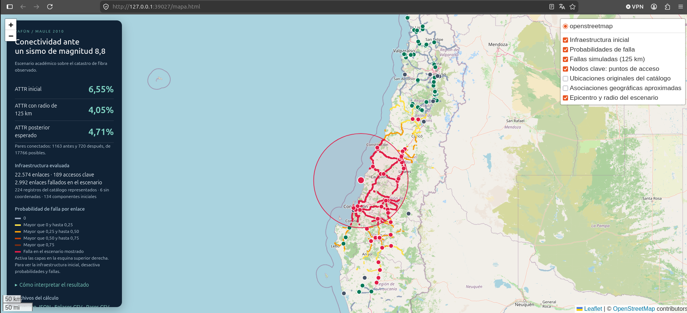

# Conectividad de la red de fibra observada ante el sismo del Maule

En 189 accesos del catastro, la probabilidad media de conexión entre dos accesos pasa de 6,55 % en operación a 4,71 % bajo el modelo sísmico. La diferencia es de -1,84 puntos porcentuales.

## Infraestructura y selección de nodos

El shapefile de la respuesta de transparencia T5610 contiene 1.915 trazados. La suma de sus segmentos de longitud positiva es de 10.312,76 km. Yafún informa cerca de 28.000 km de rutas recorridas para documentar el territorio. Las dos cifras miden cosas distintas y el grafo representa únicamente los trazados entregados.

| Categoría | Fuente y criterio | Rol asignado |
| --- | --- | --- |
| Alojamiento e interconexión | PeeringDB · instalaciones | Genera y recibe tráfico por los servicios alojados, como supuesto del modelo. |
| IXP o PIT | PeeringDB · presencias de intercambio | Intercambia tráfico entre redes. Una presencia física agrega el rol al acceso de su instalación. |
| Aterrizaje submarino | TeleGeography · localidades | Recibe e intercambia tráfico entre sistemas terrestres y submarinos. |
| Ramificación troncal | Grafo Yafún · al menos tres vecinos distintos | Distribuye tráfico entre ramales. Su función se infiere de la geometría. |

El catálogo conserva 231 registros con sus roles y fuentes. Entran al cálculo 224 registros que se agrupan en 189 accesos distintos. Se asocia cada referencia externa al extremo más próximo del segmento más cercano. La columna de distancia permite revisar la incertidumbre de cada asociación. Se supone que el acceso local funciona.

| Categoría | Ejemplo del inventario | Latitud, longitud (WGS84) | Acceso | Roles |
| --- | --- | --- | --- | --- |
| Alojamiento e interconexión | Opciones - Puerto Montt | -41,4676, -72,9403 | 5576 | genera, recibe |
| IXP o PIT | Equinix ST4 - Santiago | -34,4290, -71,0837 | 1821 | genera, recibe, intercambia |
| Aterrizaje submarino | Aterrizaje de referencia - Puerto Williams | -54,9352, -67,6059 | 20297 | recibe, intercambia |
| Ramificación troncal | Ramificacion del catastro 10057 | -29,5015, -71,2277 | 10057 | intercambia |

Los aterrizajes se ubican a escala de localidad. Las ramificaciones cuentan vecinos distintos y su identificación como puntos de intercambio es una inferencia estructural. El localizador de ODATA complementa la posición del campus ST01. Tortel se excluye por una separación cercana a 94 km sin un tramo documentado.

Registros fuera del conjunto evaluado en esta corrida: Aterrizaje de referencia - Tortel, METROWAN TELECOM Santiago, San Esteban SDC1, Telxius Valparaiso DC, Telxius Arica DC, ixFabric - Valdivia, ixFabric - Santiago.

- [Inventario con ubicación, rol, fuente y acceso de cada registro](resultados/catalogo_nodos.csv)
- [Criterios e incertidumbres de las fuentes](docs/criterios_nodos.md)

## Topología y conectividad en operación

La segmentación usa los vértices consecutivos de cada polilínea. Cada enlace se recorre en ambos sentidos con costo igual a su longitud en metros. En EPSG:4326, la tolerancia de 10⁻⁸ grados equivale aproximadamente a un milímetro en dirección norte-sur. Se usa para identificar extremos prácticamente coincidentes. Un cruce interior sin vértice compartido queda sin empalme.

```sql
SELECT pgr_createTopology('public.enlaces', 0.00000001,
    'geom', 'id', 'source', 'target', clean := true);
```

| Control de la ejecución | Resultado |
| --- | --- |
| pgr_createTopology | OK |
| Enlaces | 22.574 |
| Filas de enlaces_vertices_pgr | 22.686 |
| Componentes no dirigidos | 134 |
| Enlaces sin source o target | 0 |
| Enlaces con prob_falla = 0 al inicio (DEFAULT 0) | 22.574 |
| Enlaces marcados es_sintetico | 0 |

Hay 37 componentes con al menos un acceso clave. Dentro de cada componente, todos los accesos se alcanzan mutuamente. Antes del sismo hay 16.603 pares sin ruta. 17 accesos no alcanzan a ningún otro acceso clave de la muestra. Pueden estar unidos a otros vértices del catastro.

Accesos sin otro acceso clave alcanzable: 3805, 5256, 6757, 12549, 16875, 17187, 17660, 17835, 17974, 18591, 18879, 19734, 19824, 20297, 20379, 21317, 21319.

- [Componente de cada acceso y pares por componente](resultados/componentes_accesos.csv)
- [Identidades y roles asociados a cada acceso](resultados/nodos_clave.csv)
- [SQL de topología](sql/01_topologia.sql)

## Evento y modelo probabilístico de falla

El GeoJSON de USGS identifica el terremoto del 27 de febrero de 2010. El programa lee la geometría y los atributos del archivo, actualiza la tabla sismos y consulta el registro utilizado para calcular las distancias.

| ID en public.sismos | Magnitud | Latitud | Longitud | Profundidad (km) |
| --- | --- | --- | --- | --- |
| official20100227063411530_30 | 8,8 | -36,122 | -72,898 | 22,9 |

- [GeoJSON conservado](datos/maule_2010.geojson)
- [Consulta USGS del evento](https://earthquake.usgs.gov/fdsnws/event/1/query?format=geojson&eventid=official20100227063411530_30)

La figura 3 de Vass et al. ilustra fallas regionales correlacionadas mediante un disco. Su ejemplo usa un tamaño relativo uniforme S entre 0 y 1 y un radio de S × 50 km. Esta aplicación fija el centro en el epicentro del Maule y conserva un solo valor de S para todos los enlaces de cada realización.

```text
R = S · Rmáx,  S ~ Uniforme(0, 1)
P(falla de e) = P(R ≥ dₑ) = máx(0, 1 − dₑ/Rmáx)
```

USGS describe una ruptura de cerca de 500 km de largo. La decisión de modelado predeterminada usa su semilongitud, 250 km, como escala de un disco isotrópico. En la corrida entregada Rmáx = 250,00 km y el escenario ilustrado usa R = 125,00 km. El radio del mapa fija una realización. La esperanza integra toda la distribución. La magnitud y la profundidad identifican el evento, y la escala de daño depende del supuesto geométrico.

Para fibra se supone que basta una intersección del segmento con el disco para interrumpirlo. dₑ es la distancia mínima del epicentro al segmento completo. PostGIS la calcula en metros con ST_Distance sobre geography. Dividirla por Rmáx expresado también en metros da la probabilidad. El sismo comparte su radio entre todos los enlaces, de modo que las fallas cercanas pueden ocurrir juntas.

El modelo asignó probabilidad positiva a 5.876 de 22.574 enlaces. En el escenario ilustrado fallan 2.992. Los extremos de la siguiente tabla provienen de la corrida y los empates conservan el orden reproducible del CSV.

| Grupo | ID de enlace | Distancia al epicentro (km) | Probabilidad |
| --- | --- | --- | --- |
| Mayor | 2471 | 33,256 | 0,866975 |
| Mayor | 2472 | 33,256 | 0,866975 |
| Mayor | 2473 | 33,313 | 0,866748 |
| Mayor | 2474 | 33,325 | 0,866701 |
| Mayor | 2475 | 33,435 | 0,866261 |
| Menor | 6677 | 3.582,549 | 0,000000 |
| Menor | 18527 | 3.582,264 | 0,000000 |
| Menor | 18528 | 3.582,210 | 0,000000 |
| Menor | 6663 | 3.582,099 | 0,000000 |
| Menor | 6664 | 3.581,778 | 0,000000 |

- [Probabilidad, distancia y estado de cada enlace](resultados/enlaces_probabilidades.csv)
- [Implementación que actualiza la base](modelo_sismo.py)

## ATTR antes y después

Sea K el conjunto fijo de k accesos y sea i ↔ j el evento de que existe una ruta entre dos accesos diferentes. ATTR es el promedio de esas probabilidades sobre los pares no ordenados. Se usa la idea de confiabilidad media entre dos terminales de Neumayer y Modiano, restringida a los accesos clave.

```text
N = k(k − 1)/2
ATTR(K) = (1/N) · ∑ᵢ<ⱼ P(i ↔ j)
```

En una realización, un componente con h accesos aporta h(h−1)/2 pares. Se mantienen los 17.766 pares en el denominador incluso cuando algún acceso queda aislado. Para la esperanza se leen las probabilidades de la BD y se ordenan los umbrales 1−pₑ. Entre umbrales consecutivos la conectividad permanece constante. Se suman el ancho de cada intervalo por sus pares conectados y se divide por N. La integración es exacta bajo el supuesto de radio común.

| Condición | Pares con ruta | ATTR | Porcentaje | Cambio (pp) | Cambio relativo |
| --- | --- | --- | --- | --- | --- |
| Operación | 1.163 | 0,065462119 | 6,55 % | 0,00 | 0,00 % |
| Escenario de 125,00 km | 720 | 0,040526849 | 4,05 % | -2,49 | -38,09 % |
| Posterior esperado | Promedio sobre radios | 0,047064171 | 4,71 % | -1,84 | -28,10 % |

En el escenario ilustrado pierden su ruta 443 pares que estaban conectados. La tabla identifica los accesos con mayor pérdida de alcanzabilidad en ese escenario. Cada pérdida cuenta cuántos otros accesos clave dejaron de ser alcanzables desde ese acceso.

| Acceso | Una referencia asociada | Alcanzables antes | Alcanzables después | Pérdida |
| --- | --- | --- | --- | --- |
| 579 | Ramificacion del catastro 579 | 26 | 0 | 26 |
| 630 | Ramificacion del catastro 630 | 26 | 0 | 26 |
| 633 | Ramificacion del catastro 633 | 26 | 0 | 26 |
| 2887 | Ramificacion del catastro 2887 | 26 | 0 | 26 |
| 4508 | Ramificacion del catastro 4508 | 26 | 0 | 26 |

- [Afectación de todos los accesos](resultados/afectacion_nodos.csv)
- [Conectividad de cada par](resultados/pares_nodos.csv)

## Contraste con el 27F y alcance

Yafún documenta en su informe técnico final (§ 2.2, p. 10) que más del 60 % de la Internet chilena quedó desconectada durante unas seis horas tras el terremoto. El estudio relaciona esa interrupción con las interconexiones y los respaldos en Santiago. Durante la recuperación, el reporte publicado por SUBTEL el 3 de marzo de 2010 situó la operatividad de las redes fijas en 75 % en Maule y 45 % en Biobío.

Las tres observaciones tienen horizontes y denominadores distintos. El ATTR describe rutas entre accesos de un grafo parcial. Los reportes históricos describen desconexión y operatividad de servicios en fechas concretas. La fragmentación inicial, la cartografía de otra época y los accesos aproximados limitan la comparación nacional. El disco simplifica la geometría de ruptura y carece de calibración empírica para cable chileno. La simulación omite energía, congestión, tsunami, fallas de equipos y recuperación temporal.

## Mapa y reproducción

Leaflet muestra los enlaces por probabilidad, los accesos clave, el epicentro y el radio ilustrado. La capa de fallas simuladas muestra el estado para ese radio. Las líneas discontinuas de asociación geográfica indican proximidad a un acceso y quedan fuera del grafo de ruteo.



Figura 1. Mapa Leaflet de la corrida final sobre la red de fibra.

El SQL de la entrega se restauró sobre una base creada desde template0, con 0 tablas en public antes de la carga. Se recuperaron 22.574 probabilidades. Los tres ATTR se reprodujeron dentro de una tolerancia absoluta de 10⁻¹².

- [Instrucciones de ejecución](README.md)
- [Exportación completa](main.sql)
- [Resumen original](resultados/resumen.json)

## Fuentes

- [Proyecto Yafún · Estudio y recomendaciones sobre la resiliencia de la infraestructura de la Internet chilena, informe técnico final, versión 2.0, diciembre de 2018](https://yafun.nic.cl/estudio-resiliencia-internet-nacional/)
- [Proyecto Yafún · recorrido documentado](https://yafun.nic.cl/mapas/recorrido-yafun/)
- [PeeringDB · instalaciones e intercambios](https://www.peeringdb.com/)
- [TeleGeography · Submarine Cable Map](https://www.submarinecablemap.com/)
- [ODATA · localizador de campus](https://odatadc.com/es/localidades/)
- [USGS · síntesis tectónica del terremoto del Maule](https://earthquake.usgs.gov/earthquakes/eventpage/official20100227063411530_30/executive)
- [Vass et al. (2021) · Probabilistic Shared Risk Link Groups Modeling Correlated Resource Failures Caused by Disasters, fig. 3](https://doi.org/10.1109/JSAC.2021.3064652)
- [Neumayer y Modiano (2016) · Network reliability under geographically correlated line and disk failure models, def. 9](https://www.mit.edu/~modiano/papers/CV_J_83.pdf)
- [SUBTEL · reporte de telecomunicaciones en las regiones afectadas, 3 de marzo de 2010](https://www.subtel.gob.cl/reporte-telecomunicaciones-en-regiones-afectadas-emitido-por-el-ministerio-del-interior/)

[Evidencia de la restauración](resultados/ruteo_verificacion_660d1d692709408a.json)
